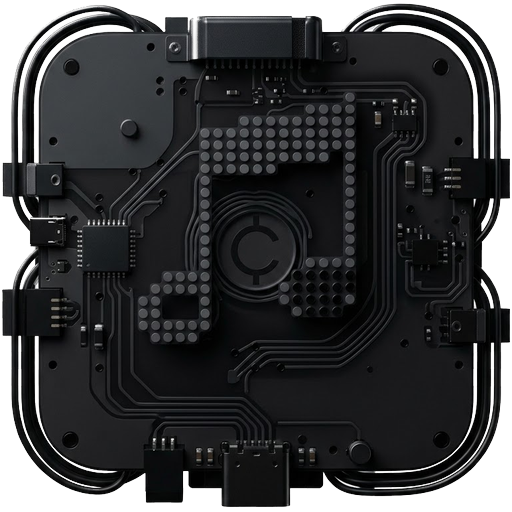

# CentiMusic

A minimalist, fully offline Android music player inspired by Nothing's design language: monochrome surfaces, dot-matrix type, geometric
artwork and a single red accent. It plays the music already on your phone. There are no accounts,
no streaming and no network permission.

> CentiMusic is an independent project. It is not affiliated with, endorsed by or a product of Nothing Technology Ltd.,
> and it does not use Nothing's logos.

## Features

| Area | What it does |
| --- | --- |
| **Library** | Scans MediaStore for local audio (title, artist, album, duration, track no., year, folder, artwork). Rescans automatically when files change, and on demand. Duplicates are removed by content URI. |
| **Import** | Pick audio files from any folder or document provider with the system file picker (persisted read access). Also opens audio from "Open with" in file managers. |
| **Home** | Dot-matrix hero, Shuffle all, Recently Played, Recently Added and Albums shelves, built from your real library. Empty, loading and permission states. |
| **Library screen** | Liked Songs, Playlists, Albums, Artists, All Songs, Folders, Recently Played, Recently Added — with live counts. Album/artist/folder detail pages with Play, Shuffle and Add-to-playlist. Song sorting (title, artist, album, date added, duration) and album sorting. |
| **Search** | Accent- and case-insensitive search over songs, artists, albums and playlists, recent searches with per-item delete and Clear, and a "Your artists" shortcut row drawn from your own library. |
| **Playlists** | Create, rename, delete, add/remove songs, drag to reorder, play, shuffle, song count and total duration. Stored in Room. |
| **Now Playing** | Large artwork with animated transitions, dot-matrix title, like, seek bar with scrubbing, shuffle, previous, play/pause, next, repeat (off/all/one), current audio output, queue. |
| **Queue** | Mirrors the real ExoPlayer playlist in play order: now playing, up next, tap to jump, remove, drag to reorder (when shuffle is off), clear. |
| **Playback** | Media3 ExoPlayer inside a `MediaSessionService`: background playback, media notification, lock-screen and Bluetooth/headset controls, audio focus, pause on "becoming noisy", skip silence, missing-file skipping, and queue/position restore (including Android's media resumption). |
| **Launch** | Animated splash: the dot equalizer from the app icon bounces, the CentiMusic wordmark types out in dot-matrix, then "Made by Vincent with ♥" fades in. It continues seamlessly from the system launch screen (AndroidX SplashScreen), plays once per launch, and can be skipped with a tap. |
| **Settings** | Theme (System/Light/Dark, applied instantly), remember shuffle & repeat, resume last queue, pause on disconnect, skip silence, ignore short audio, rescan, import, clear search history, privacy, about, version. Stored in DataStore. |

## Tech stack

Kotlin · Jetpack Compose (Material 3 for dialogs/sheets only) · Media3 ExoPlayer + MediaSession ·
Room · DataStore · Navigation Compose · [Reorderable](https://github.com/Calvin-LL/Reorderable) for
drag-and-drop · Gradle Kotlin DSL with a version catalog.

- `minSdk` 26 (Android 8.0), `compileSdk`/`targetSdk` 35
- AGP 8.9.1, Kotlin 2.1.20, Gradle 8.14.3 (wrapper included)

## Project structure

```
app/src/main/java/com/centimusic/player/
├── CentiMusicApp.kt, AppContainer.kt, MainActivity.kt   app layer, manual DI
├── data/
│   ├── media/        Song/Album/Artist/Folder models, MediaStore scanner, artwork loader, MusicRepository
│   ├── database/     Room entities, DAOs, AppDatabase
│   ├── preferences/  DataStore-backed settings
│   └── repository/   Playlists, favourites, play & search history
├── playback/         PlaybackService (ExoPlayer + MediaSession), PlayerConnection (MediaController → StateFlow), output monitor
├── navigation/       Routes, Navigator, root scaffold (NavHost, bottom bar, mini-player, permissions, file picker)
└── ui/
    ├── theme/        Colors, typography (Doto dot-matrix + sans), spacing, custom stroke icon set
    ├── components/   Artwork + generated placeholders, grain texture, rows, mini-player, bottom nav, sheets, dialogs
    └── home/ player/ library/ search/ playlists/ queue/ settings/
```

UI state flows one way: repositories expose `Flow`s → ViewModels combine them into immutable UI
state → Compose renders it. Every playback command goes through the `MediaController`, so the
app, notification, lock screen and headset buttons always agree.

## Building

Requirements: JDK 17+ and the Android SDK (platform 35). Android Studio Ladybug or newer works out of the box.

```bash
./gradlew assembleDebug          # → app/build/outputs/apk/debug/app-debug.apk
./gradlew testDebugUnitTest      # JVM unit tests
./gradlew installDebug           # install on a connected device
```

If the SDK isn't auto-detected, create `local.properties` with `sdk.dir=/path/to/Android/sdk`.

### CI

`.github/workflows/android.yml` builds the debug APK and runs the unit tests on every push. The APK
is attached to each run as the **centimusic-debug-apk** artifact.

## Permissions

| Permission | Why |
| --- | --- |
| `READ_MEDIA_AUDIO` (Android 13+) / `READ_EXTERNAL_STORAGE` (Android 8–12, `maxSdkVersion 32`) | Read the device's audio through MediaStore. No broad storage access is requested. |
| `FOREGROUND_SERVICE`, `FOREGROUND_SERVICE_MEDIA_PLAYBACK` | Keep playing in the background. |
| `POST_NOTIFICATIONS` (Android 13+) | Show the playback notification. |
| `WAKE_LOCK` | Keep the CPU awake while playing with the screen off. |

If audio access is denied the app still works with files picked through the system file picker.

## Design

Dark: background `#080808`, text `#FFFFFF` / `#A0A0A0`, dividers `#252525`.
Light: background `#FAFAF8`, text `#111111` / `#686868`, dividers `#E5E5E2`.
Accent `#FF3030` in both. Large headings use **Doto** (dot-matrix, SIL OFL 1.1 — see
`licenses/Doto-OFL.txt`); metadata uses the system sans-serif. Icons are custom vectors drawn on a
24-unit grid with one 1.6 stroke weight.

### App icon



The launcher icon is a black circuit-board device carrying a dot-matrix music note and a "C", on a
**transparent background**: the adaptive icon's background layer is transparent, so only the device
is drawn on the home screen. The foreground ships as PNGs for every density
(`app/src/main/res/mipmap-*/ic_launcher_foreground.png`), sized to 58dp of the 108dp canvas so that no
launcher mask shape clips it. `docs/icon.png` is a 512px transparent version.

The launch screen and animated splash use a separate vector mark (`drawable/ic_centimusic_mark.xml`):
an original dot-matrix equalizer of white dots with one red dot, which the splash animation is built from.
