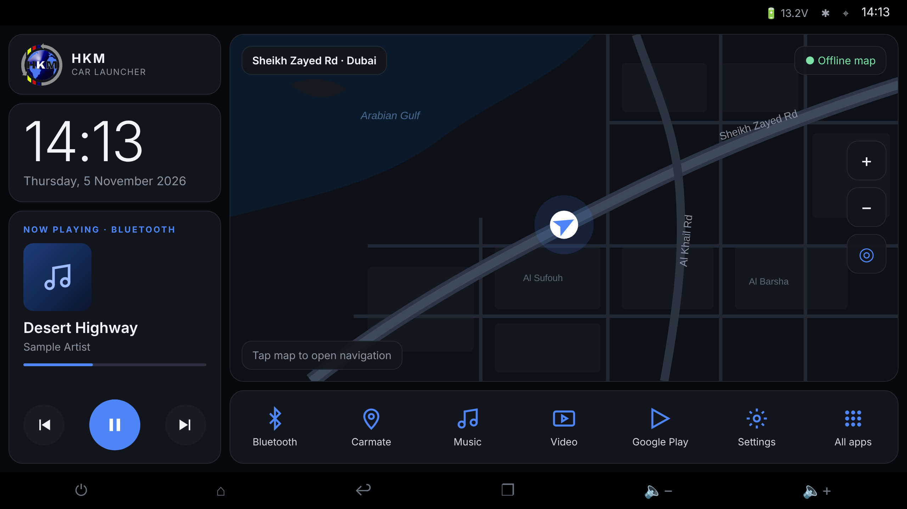

# HKM Car Launcher — Design

Date: 2026-11-05
Status: draft, awaiting review

## 1. Goal

Replace the stock home screen on the owner's Android head unit with a dark, high-contrast, HKM-branded
launcher whose main area is a live map (online and offline) of where the car is.

### Target device

| Item | Value |
| --- | --- |
| Type | Generic Chinese Android 2-DIN head unit, "T100" platform |
| Android | 15 |
| RAM / storage | 4 GB / 64 GB |
| Screen | 1280×720, landscape, touch |
| System bars | Vendor status bar on top, vendor button bar (power, home, back, recents, volume) at the bottom. They stay; the launcher draws between them. |
| Region | UAE |

### What the owner decided

| Topic | Decision |
| --- | --- |
| Main area | Live map following the car. Tap opens the navigation app. No search or routing in the launcher. |
| Left column | HKM logo, large clock + date, "Now playing" card for any audio source. |
| Dock | Fixed: Bluetooth, Carmate, Music, Video, Google Play, Settings, plus All apps. Not customisable. |
| Style | Dark, high contrast. Accent is the blue from the HKM logo (`#4F86F7`). |
| Map tech | MapLibre vector map, online when there is internet, offline UAE file otherwise. |
| Code location | A new `:launcher` module inside the CentiMusic repository. Independent of the CentiMusic app: separate package, separate APK, no shared code. |

### Out of scope (YAGNI)

Search, routing, turn-by-turn, FM radio tuning (only the vendor radio app can drive the QN8035 chip), weather,
custom dock, extra pages, widgets, light theme, other countries' offline maps, phone layouts/portrait.

## 2. Architecture

One Android application module, `launcher/`, added to the existing Gradle build (`include(":launcher")`),
reusing the wrapper and version catalog. Package and application id: `com.hkm.carlauncher`.
`minSdk` 26, `target/compileSdk` 35, Kotlin + Jetpack Compose, landscape only.

The main activity declares the `MAIN` + `HOME` + `DEFAULT` intent filter, so Android offers it as the
home app. Pressing the unit's Home button returns to the main screen and closes All apps.

### Units

Each unit has one job and a small interface; the UI only sees `StateFlow`s and plain callbacks.

| Unit | Responsibility | Depends on |
| --- | --- | --- |
| `HomeScreen` (Compose) | Lays out logo, clock, now-playing card, map, dock (as in the mockup). | All state holders below |
| `ClockState` | Emits current time/date each minute; follows system 12/24 h setting. | System clock |
| `NowPlayingRepository` | Finds the active media session, exposes title, artist, artwork, source app name, position/duration, play state; sends play/pause/next/previous. | `MediaSessionManager`, `LauncherNotificationListener` |
| `LauncherNotificationListener` | Empty `NotificationListenerService`; it exists only because Android requires it before an app may read other apps' media sessions. | — |
| `MapController` | Owns the MapLibre `MapView`: style, source choice, camera follow, zoom, re-centre, current street name. | `MapSourceSelector`, `LocationRepository` |
| `MapSourceSelector` | Decides which tiles to use: offline file if installed, else online. Pure logic. | `OfflineMapStore`, connectivity |
| `OfflineMapStore` | Downloads, imports (USB/file picker), verifies and stores the UAE map file. | `DownloadManager`, file picker |
| `LocationRepository` | GPS fixes from `LocationManager` (no Google Play services dependency), last known position. | Location permission |
| `DockResolver` | Maps the six fixed dock entries to installed apps. Pure logic over a list of installed apps. | `PackageManager` |
| `AppsRepository` | List of launchable apps for All apps, refreshed on install/uninstall. | `PackageManager`, package broadcasts |
| `NavigationLauncher` | Opens the chosen navigation app when the map is tapped. | `PackageManager`, settings |
| `LauncherSettings` | Stores the chosen navigation app and map state (DataStore). | DataStore |

## 3. Screens

### 3.1 Main screen (1280×720 between the system bars)

- **Left column (300 dp wide):**
  - Logo card: HKM logo (background removed: `docs/launcher/hkm-logo.png`) with "HKM / CAR LAUNCHER".
    Long-pressing it opens Launcher settings (kept out of the way so it can't be hit by accident while driving).
  - Clock card: time in large light type, full date below.
  - Now playing card: source label (e.g. "NOW PLAYING · BLUETOOTH"), artwork (or a note icon), title,
    artist, progress bar, previous / play-pause / next (play-pause 72 dp, others 58 dp). Tapping the
    text or artwork opens the app that is playing.
- **Map (remaining width):** dark style, car marker at the GPS position pointing in the direction of travel.
  Overlays: current street name (top left), "Offline map" / "Online map" indicator (top right),
  zoom +/− and re-centre buttons (right), hint "Tap map to open navigation" for the first few launches.
  - The camera follows the car unless the user pans. Re-centre (or 15 s with no touch) resumes following.
  - A single tap (not a pan or zoom) opens the navigation app.
- **Dock (104 dp tall):** Bluetooth, Carmate, Music, Video, Google Play, Settings, All apps.
  Minimum touch target 72 dp. Icons are drawn by the launcher in the accent colour for a uniform look.

### 3.2 All apps

Full-screen dark grid of every launchable app (system icon + label), alphabetical, excluding the launcher
itself. Tap launches; Back or Home returns to the main screen.

### 3.3 Launcher settings (long-press the logo)

- **Navigation app:** pick from installed apps. Default: Google Maps if installed, else Carmate, else ask
  on first tap.
- **Offline map:** status (not installed / downloading xx% / installed, size, date), Download, Load from USB
  (file picker), Delete.
- **Permissions:** status and buttons for Location and Notification access.
- **Set as home app:** opens the system default-home picker.
- Version.

## 4. Map details

- **Library:** MapLibre Native for Android, embedded through `AndroidView` in Compose.
- **Online tiles:** OpenFreeMap vector tiles (OpenMapTiles schema, free, no API key).
- **Offline tiles:** a UAE vector tile file in the same OpenMapTiles schema, so one dark style serves both.
  - Built by us with Planetiler from the OpenStreetMap UAE extract, in a GitHub Actions workflow, and
    published as a GitHub Release asset of this repository. Expected size 50–150 MB (measured when
    first built). Licence: OpenStreetMap ODbL; the map shows "© OpenStreetMap contributors".
  - Format: PMTiles or MBTiles, whichever the chosen MapLibre version reads from a local file. The first
    implementation task verifies this; fallback is a tiny in-app localhost tile server reading MBTiles.
- **Style, sprites and fonts** are bundled in the APK's assets so the offline map needs no network at all.
- **Labels:** English names (`name_en`) first, falling back to the local name. Arabic-only names may not be
  shaped correctly by MapLibre Native; this is accepted for v1.
- **Source choice:** offline file installed → use it (fast, works everywhere). Otherwise → online tiles.
  The indicator shows which one is in use.
- **Street name:** the road feature under the car position, queried from rendered features when the
  position changes.
- **Getting the file:** Settings → Download (Android `DownloadManager`, survives reboots, resumes) or
  Load from USB (copy via file picker). The file is checked (size + SHA-256 from the release) before use.
  On first launch with internet and no file, the launcher offers the download once.

## 5. Now playing details

- Uses `MediaSessionManager.getActiveSessions()` with the notification listener component, choosing the
  session that is playing, else the most recently active one.
- Progress is computed from `PlaybackState` position, its update time and playback speed, ticking each second.
- Whether the vendor radio and Bluetooth music apps publish media sessions is unknown until tested on the
  unit. If one doesn't, the card can't show it; that is accepted.
- Without notification access the card shows "Allow access to show what's playing" with a button to the
  system page.
- With no session: "Nothing playing" and a button that opens the Music app.

## 6. Dock resolution

The vendor apps' package names aren't known yet. `DockResolver` matches each entry against installed
launchable apps:

| Entry | Match order |
| --- | --- |
| Bluetooth | label "Bluetooth" (case-insensitive) → label contains "bt" |
| Carmate | label "Carmate" |
| Music | label "Music" (excluding this launcher) |
| Video | label "Video" |
| Google Play | package `com.android.vending` |
| Settings | label "Settings" from a vendor package → `android.settings.SETTINGS` |

Matches can be pinned to exact package names once the owner reports them (one line in code).
An entry with no match opens All apps.

## 7. Errors and empty states

| Situation | Behaviour |
| --- | --- |
| No location permission | Map centred on Dubai; banner "Allow location" with a button. |
| Permission granted, no GPS fix yet | Last known position if any, else Dubai, with "Waiting for GPS…". |
| No offline file and no internet | Map area shows "Map not available — connect to the internet once, or load the UAE map from USB" with buttons. |
| Download fails | Status shows the error and Retry; partial file is removed. |
| Imported/downloaded file fails the check | Rejected with a message; the old file (if any) stays in use. |
| Navigation app missing | Tap opens the navigation-app picker in settings. |
| Launched app missing (dock) | Opens All apps. |

## 8. Testing

- **Unit tests (JVM)** for the pure logic: `DockResolver`, `MapSourceSelector`, now-playing session choice
  and progress maths, street-name picking from feature lists, offline file verification.
- **Compose UI test** for the main screen with fake state holders: all regions render at 1280×720, buttons
  call their callbacks, empty states show.
- **CI:** extend `.github/workflows/android.yml` to build the launcher APK and upload it as an artifact, so
  it can be installed on the unit from a USB stick. A separate manual workflow builds the UAE map file.
- **On the unit (manual checklist):** set as home app; GPS follow while driving; offline mode with Wi-Fi off;
  now playing with Bluetooth music and the radio app; each dock button; Home button behaviour; legibility
  in daylight.

## 9. Assets

- `docs/launcher/hkm-logo-original.jpg` — logo as supplied.
- `docs/launcher/hkm-logo.png` — background removed, used in the app.
- `docs/launcher/main-screen-mockup.png` — approved layout.
