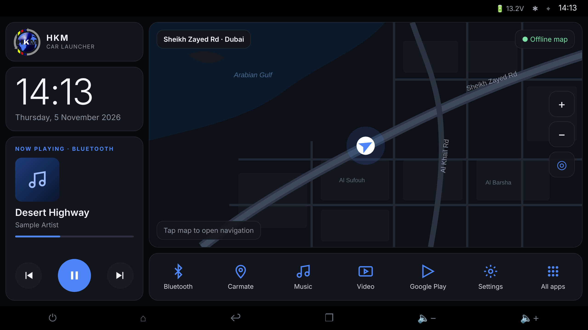

# HKM Car Launcher

A dark, high-contrast home screen for the HKM car head unit (generic Android 15 "T100" unit,
1280×720). The main area is a live map that follows the car, online or fully offline for the UAE.
It's a separate app from CentiMusic and only lives in this repository.



| Area | What it does |
| --- | --- |
| Logo card | HKM logo. **Long-press** it to open the launcher settings. |
| Clock | Large time and date; follows the unit's 12/24-hour setting. |
| Now playing | Whatever is playing (Bluetooth, radio app, music apps): artwork, title, artist, progress, previous / play-pause / next. Tap the title to open the playing app. |
| Map | Dark map, car arrow with heading, current street name, Offline/Online indicator, zoom and re-centre. Panning stops following for 15 s. **Tap the map** to open your navigation app. |
| Dock | Bluetooth, Carmate, Music, Video, Google Play, Settings, All apps. |

## Install on the head unit

1. Open the latest **Android build** run in the repository's Actions tab and download **HKM-Launcher.apk**.
2. Copy it to a USB stick, plug it into the unit and open it with the unit's file manager to install
   (allow installing from unknown sources if asked).
3. Press the **Home** button and choose **HKM Launcher**, then **Always**. You can also do this later
   from the launcher settings: *Set as home app*.

### First run

- **Location:** allow it, so the map follows the car.
- **Now playing:** tap *Allow* on the card and switch on **HKM Launcher** in *Notification access*.
  Android requires this before any app can show or control music from other apps.
- **Offline map:** when the unit first has internet (Wi-Fi or a phone hotspot), the launcher offers to
  download the UAE map once. Until then the map uses online data.

## Offline map

The map file is built from OpenStreetMap by the **UAE offline map** workflow and published as the
release [`uae-map`](https://github.com/syberdeath/CentiMusic/releases/tag/uae-map)
(`uae.pmtiles` plus its SHA-256 checksum).

- **Download:** launcher settings → *Offline map* → *Download* (or *Update* for a newer map).
- **From USB:** download `uae.pmtiles` from the release on a computer, copy it to a USB stick, then
  launcher settings → *Load from USB*. Without internet the file is checked by its header only.
- A download that fails or is interrupted is thrown away; the previous map stays in use.
- To refresh the map data, re-run the **UAE offline map** workflow.

Map data © OpenStreetMap contributors (ODbL). Online tiles from OpenFreeMap.

## Dock apps

The head unit's own Bluetooth, Music, Video and Carmate apps are found **by name**. If a button
opens *All apps* instead of the right app, find the app's package name (*Settings → Apps*) and pin it
in `AppGraph.kt`:

```kotlin
val dockResolver = DockResolver(
    selfPackage = app.packageName,
    pinned = mapOf(DockEntry.MUSIC to "com.example.vendor.music"),
)
```

## Building

`./gradlew :launcher:assembleDebug` (CI also runs `launcher/scripts/fetch-fonts.sh` first, which
downloads the map label fonts into the git-ignored `src/main/assets/map/fonts/`).

Code layout (`src/main/java/com/hkm/carlauncher/`):

```
apps/      installed apps, dock matching, All apps screen
clock/     clock text and card
media/     media-session reader, session choice, Now playing card
location/  GPS fixes
map/       map source choice, offline file store, dark style, MapLibre panel
settings/  stored choices, navigation-app launching, settings screen
home/      logo card, dock, home screen layout
```

Pure logic has JVM unit tests; screens have Robolectric Compose tests (`./gradlew :launcher:testDebugUnitTest`).

## On-unit checklist

These can only be confirmed on the head unit itself:

- [ ] Pressing Home always returns to the launcher; Home from All apps or settings returns to the main screen.
- [ ] The map follows the car while driving and the arrow points the way you're going; it keeps its heading when stopped.
- [ ] With Wi-Fi off and the offline map installed, the map still draws streets and labels ("Offline map").
- [ ] The street name chip shows the road you're on.
- [ ] Now playing shows Bluetooth music from a phone, and whether it shows the stock radio app.
- [ ] Each dock button opens the right app (Bluetooth, Carmate, Music, Video, Google Play, Settings).
- [ ] Tapping the map opens the chosen navigation app.
- [ ] Everything is readable in bright daylight.
